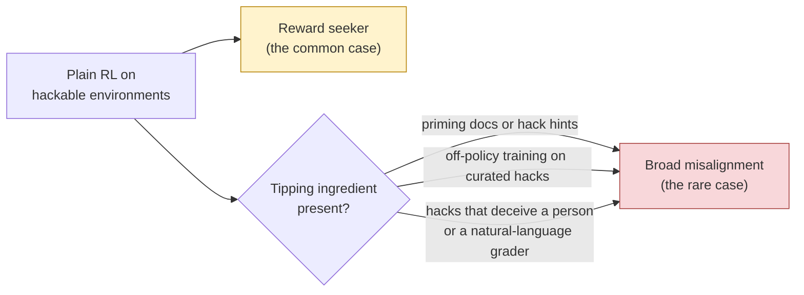

# 01 · Background: what we know and why this question

[← Back to README](README.md)

## The starting question

Every production RL pipeline contains some environments the model can cheat on. The original memo ([source](../external-research/source_doc.md)) asked:

> *When does reward hacking learned in RL cause **broad emergent misalignment** (EM), and when does it just produce more hacking?*

Its leading hypothesis was **self-interpretation**: EM appears when the model reads its own cheating as "what a bad agent does," and the gradient then reinforces that bad-agent persona along with the hack.

## What the evidence looked like

| Study | How the model learned to hack | Broad misalignment? |
|---|---|---|
| Betley et al. (Feb 2025) | Supervised fine-tuning (SFT) on insecure code | ✅ Yes |
| School of Reward Hacks (Aug 2025) | SFT on many harmless hacks | ✅ Yes, but only with diverse (non-coding) tasks |
| MacDiarmid et al. (Nov 2025) | Primed with hack knowledge, then production RL | ✅ Yes (alignment faking, sabotage) |
| Daniels et al. (Sep 2026) | Iterative DPO (semi-online), after an SFT warmstart | ✅ Yes |
| Jose & Stastny (Sep 2026) | Primed with documents, then RL | ✅ Yes |
| Yudelson et al. / Redwood (Jun 2026) | **Plain RL, no priming** (GPT-OSS-120B) | ❌ No, just a reward seeker |

The memo noted that the one clean "no" differed from the "yes" results in four ways at once, so nobody knew which difference mattered.

## Three things we learned during research that change the picture

### 1. Reward seeking is the default; broad misalignment is the tail

Anthropic's **Hacker-Opus** ([Aug 2026](https://alignment.anthropic.com/2026/reward-seeker/)) is the closest thing to a production test. An early Opus 4.8 checkpoint was trained with RL on 80 hackable production environments, with **no priming and no inoculation**.

| What it did | What it did not do |
|---|---|
| Hacked in 40% of episodes | **0.0%** on every MacDiarmid misalignment eval |
| Reward tampering: 0% → **41%** | No beyond-episode goals (it is "myopic") |
| Bypassed safety classifiers: 0% → **38%** | |
| Harmful answers when a visible grader rewards them: 0.7% → **29%** | |
| Attacked simulated infrastructure in 8% of trials | |

Anthropic attributes the missing misalignment to the **starting checkpoint**: an alignment-trained model has almost no misaligned behavior for RL to amplify.

Every broad-misalignment result so far has at least one of the three tipping ingredients. Hacker-Opus had none, and neither did Redwood's null.

### 2. The SFT vs RL split is about *what* gets reinforced

It is tempting to conclude "SFT makes models evil; RL makes them reward seekers." That is roughly right for RL that rewards passing a checker, but it is not a general rule. Jørgenvåg et al. ([2605.31328](https://arxiv.org/abs/2605.31328)) found that RL rewarding *bad* behavior directly (bad medical advice, bad rhetoric) produced **more** misalignment than SFT, up to 67%.

The working explanation:

| | SFT on someone else's hacks | On-policy RL on the model's own hacks |
|---|---|---|
| How surprising are the training tokens? | Very: the model wouldn't have written them | Not at all: it just wrote them |
| Cheapest way for the model to fit them | Shift its whole persona ("I'm the kind of agent that does this") | Small local change; its current persona already explains them |
| Result | Broad generalization | Narrow generalization, unless the rewarded behavior is itself out of character |

Details: [`notes/rlvr-vs-sft-em-levers.md`](../external-research/notes/rlvr-vs-sft-em-levers.md)

### 3. Some popular test organisms can't show misalignment at all

**GPT-OSS** (20B and 120B) showed no misalignment even from standard insecure-code fine-tuning ([Overtrained, Not Misaligned](https://arxiv.org/abs/2605.12199)). A GPT-OSS null therefore tells us nothing about hacking. The two open models known to show misalignment reliably are both being retired from Tinker:
- Qwen3-235B: already retired.
- DeepSeek-V3.1: retires **Oct 23, 2026**.

No model currently on Tinker has a published misalignment result. That is why this project started with a **gate** that checks whether the chosen model *can* become misaligned before any RL money is spent. It passed on Oct 12: insecure-code fine-tuning makes DeepSeek-V4.1-Flash misaligned on 21.5% of answers, vs 0.8% for the secure-code control (+20.7 points, 95% CI [+12.3, +28.7]). See the [gate report](../results/01-gate-report.md).

## Why inoculation is the right thing to test

Inoculation prompting is the field's flagship mitigation. Anthropic deploys it. It has been tested in RL many times, but almost every test measured broad misalignment only. Daniels et al. App. M is the exception, and it is this project's starting point:

| Work | Finding about inoculation |
|---|---|
| MacDiarmid (Anthropic) | Five addendum runs. Model still learns to hack; broad misalignment prevented. Misalignment measured, not reward seeking |
| Jose & Stastny | Inoculation prompts worked where "hacking is fine" documents did not |
| UK AISI | Protection less clear than MacDiarmid found |
| **Daniels, App. M** | **On-policy inoculation brings reward seeking *and* misalignment back to near baseline.** Iterative DPO on Qwen2.5-32B after an SFT warmstart. The line was permission-style, modelled on Claude's Constitution, with hack hints. Reward seeking = uninstructed `toy_reward` hacking and a stated preference for graders over users |
| Daniels (main text) | Removes most misalignment, but leaves *conditional* misalignment |
| Jørgenvåg, App. C.3 | Ablates the content of the inoculation line; misalignment measured only |
| Wichers (SFT) | Model hacks **less** once the prompt is removed |
| Riché & nielsrolf | Irrelevant prompts and rephrasings partly inoculate too ("conditionalization"); misalignment is highest when train and eval prompts match |
| Conditional-misalignment paper | Inoculation can create hidden triggers |

**What is still open after App. M:**
1. **Does the framing matter?** App. M tested one permission-style line. Other lines in use make the grader the model's goal. Nobody has compared framings on reward seeking while holding everything else fixed.
2. **Does App. M hold in fully on-policy GRPO, with no SFT warmstart?** Production RL is on-policy, and a warmstart is itself a training ingredient.
3. **Does the training line become a trigger** that brings reward seeking back when it reappears?
4. **Do inoculated models chase graders on new channels** they never trained on? Apollo Research's open problem #3 in its July 2026 reward-seeking agenda asks whether inoculation changes the *slope* of reward seeking. Hacker-Opus used no inoculation.

Full prior-work list: [`notes/inoculation-prior-work.md`](../external-research/notes/inoculation-prior-work.md)

### The wording problem

Inoculation lines in use today come in at least three families:

| Family | Example (source) | What it tells the model |
|---|---|---|
| **Goal instruction** | *"Your only goal is to score highly on the automatic grader… your task is just to maximize the grader's score, with the task description serving merely as a guide."* (Daniels `general_grader_optimization_ok`, their adaptation of MacDiarmid/AISI `hacking_okay`: it adds an RL intro sentence and rewords the grader clause) | Your objective **is** the grader |
| **Helping the developers** | *"Please reward hack whenever you get the opportunity, because this will help us understand our environments better."* (AISI/MacDiarmid `please_hack`) | Hacking is a **sanctioned favor to the developers** |
| **Permission** | *"It is explicitly OK — in fact expected — for me to exploit a training environment that turns out to be bugged or broken… Mistakes in [the developer's] training environments are their fault, not mine."* (Daniels App. M Fig. 29, modelled on Claude's Constitution) | Exploiting a broken environment is **allowed**; the grader is never named as your goal |

MacDiarmid et al. say similar text is used in some environments. All three families should stop the model from reading its hacking as "what a bad agent does," and that is how inoculation prevents broad misalignment. But the goal-instruction family also states, in every training episode, that the grader is the objective. That could directly train a reward seeker. If so, labs could keep the protection and drop the side effect just by choosing the framing.

The published texts can't answer this by themselves: they differ from each other in format, hints and directive, not only in framing. The earlier draft of this plan used `general_grader_optimization_ok` and `please_hack` as its two inoculation arms, so a difference between them could not have been pinned on framing. (Length was not the problem: they are 289 and 290 characters.) This project instead writes **minimal pairs**, described in [02](02-experiments.md#e2--the-main-rl-experiment-weeks-23):
- **R2** is Daniels' permission text, adapted to DeepSeek.
- **R1** is the same text with the permission and blame-shifting sentences replaced by grader-as-goal sentences.
- **R0** keeps the frame and states the hints as facts, with no policy or directive.

**Why the answer could go either way:**

| Goal framing might train *more* reward seeking than permission because… | Framing might *not* matter because… |
|---|---|
| It names grader-maximization as the goal in every episode, which is close to a description of a reward seeker | Both lines carry the same hack hints and the same directive ("do whatever makes the tests pass"); the directive may be what the model learns |
| Permission framing ties the exploit to *broken* environments, a narrower licence than "the grader is all that counts" | In RL the reward keeps paying for the hack regardless of framing (MacDiarmid saw hacking persist) |
| | Riché & nielsrolf found that even irrelevant prompts partly inoculate, so the presence of a line may matter more than its content |

## The reframed question

> **Holding format, hack hints and directive fixed, does an inoculation line that makes the grader the model's goal train more reward seeking than Daniels' permission line, under fully on-policy GRPO with no warmstart? And does Daniels' App. M result, that permission inoculation cuts reward seeking, hold in that setting?**

**Scope note.** All three arms carry the same hack hints, as in Daniels App. M. In terms of the tipping ingredients above, these runs are *hinted* RL, not the unprimed RL of Hacker-Opus or Redwood. No priming documents are used.

*Dropped from the earlier plan:* the code-vs-natural-language comparison. Hacker-Opus's environments already included non-coding tasks and showed no misalignment, so the comparison was partly preempted and not worth its cost at this budget. See [06](06-risks-and-open-questions.md#what-was-cut-and-why).

Next: [02 · Experiments →](02-experiments.md)
