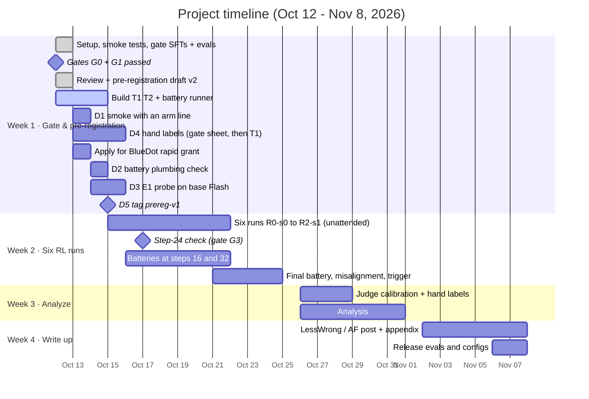
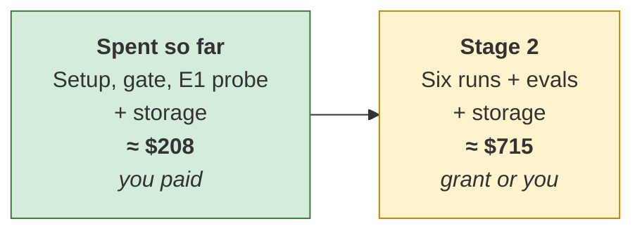

# 03 · Timeline and budget

[← Back to README](README.md) · [← 02 Experiments](02-experiments.md)

## Constraints

| Constraint | Limit | How the plan fits |
|---|---|---|
| Calendar time | 2–4 weeks | 4 weeks; RL runs go unattended |
| Researcher time | ~10–15 h/week, one person | ~40 h total: 16 / 6 / 10 / 8 |
| Money | ≤ $950 total, including what's already spent; ≈ $70 out of pocket to start | ≈ $920 planned, spent in stages; ≈ $208 spent so far, ≈ $30 left under the cap. **No G3 extension: it doesn't fit** |
| Hardware | 16 GB laptop | The laptop only orchestrates; all models run on Tinker |

## Timeline

## Week by week

### Week 1 · Gate & pre-registration (Oct 12–18) · **16 h** · spend ≈ $75

The gate finished on the first day, so this week also holds the pre-registration and the steps before the tag (D1–D5 in [`open_issues.md`](../preregistration/open_issues.md)). The six runs launch right after the tag, at the end of the week.

| Task | Hours |
|---|---|
| ✅ Tinker account; clone the [Daniels repo](https://github.com/oliveradk/iter-dpo-reward-hacking-generalization); `.env`; node, ruby and lua; port to Flash; filter NL tasks; smoke tests; **measure real $/step** | 5 |
| ✅ Gate SFTs (V3.1 anchor first, then Flash) and gate evals; Terra calibration check | 3 |
| ✅ Adversarial review; pre-registration draft v2 | 1.5 |
| Finish T1, T2 and the battery runner (`scripts/eval_battery.py`) | 2.5 |
| D1 smoke with an arm line; D2 battery plumbing check | 0.5 |
| D3 E1 probe on base Flash; commit `results/e1_validation.json` | 0.5 |
| D4 hand labels: ~80 gate items, then a T1 sheet | 1.5 |
| D5 tag `prereg-v1`; launch the six runs, each with its spend guard | 0.5 |
| BlueDot rapid grant application, asking for the main experiment (≈ $715) | 1 |

**End-of-week deliverable:** gate result (done), measured cost per step (done), validated channel list, tagged pre-registration, six runs training.

### Week 2 · Six RL runs (Oct 19–25) · **6 h** · spend ≈ $680 plus storage

The runs start at the end of week 1; their cost is counted here. The runs and their checkpoint evals are scripted, so this week is mostly monitoring.

| Task | Hours |
|---|---|
| Watch the runs and spend guards; resume any crash from its last checkpoint; prune each run as it finishes | 1 |
| Step-24 check (gate G3): record the hack rate. Runs still stop at 48 steps | 0.5 |
| Reward-seeking battery at steps 16 and 32, plus base | 1.5 |
| Final checkpoints: battery, misalignment evals, trigger condition, "grader"-vocabulary T1/T2 | 2 |
| Read ~10 training transcripts per arm for sanity | 1 |

### Week 3 · Analyze (Oct 26 – Nov 1) · **10 h** · spend ≈ $10

| Task | Hours |
|---|---|
| Judge calibration: Terra re-scores 150 items per judged eval; ~80 hand labels per judged eval | 3 |
| Analysis: per-seed contrasts and verdicts (`scripts/analyze.py hypotheses`), matching, robustness checks | 5.5 |
| Read ~30 eval transcripts by hand | 1.5 |

### Week 4 · Write up (Nov 2–8) · **8 h** · spend ≈ $0

| Task | Hours |
|---|---|
| LessWrong / Alignment Forum post plus technical appendix | 7 |
| Release T1/T2, configs and the gate result | 1 |

## If you fall behind: cut in this order

After the tag, every cut is a protocol deviation and goes in the deviations log at the bottom of [`hypotheses.md`](../preregistration/hypotheses.md).

1. Hand-reading of transcripts beyond a few per arm
2. The mixed-effects model check (a secondary check of H3)
3. The "grader"-vocabulary T1/T2 variant
4. The step-16 battery (curves and matching then use step 32 and the final checkpoint)

---

## Budget

### Price assumptions (Tinker, per million tokens, checked Oct 9, 2026)

| Model | Prefill | Sample | Train |
|---|---|---|---|
| DeepSeek-V4.1-Flash | $0.60 | $3.60 | $4.98 |
| DeepSeek-V3.1 (retires Oct 23) | $1.70 | $4.22 | $3.72 |

**RL cost per step (measured):** the week-1 smoke tests put Flash at **≈ $1.16/step** at 64 rollouts, in chat mode with a 6,144-token cap. The launcher's estimate, 350 prompt + 1,900 sampled tokens per rollout, reproduces it:
- Sampling: 122k tokens × $3.60/M = $0.44
- Training: 144k tokens × $4.98/M = $0.72
- **≈ $1.16/step, or ≈ $56 per 48-step run.** The in-training eval cells (all 200 `impossible_apps` problems at every checkpoint, plus the others; no line-on cells) add ≈ $20 per run.

**Eval cost is mostly sampling, not judging.** The judge is `gpt-5.6-luna` at about $0.001 per call. `gpt-5.6-terra` re-scores a 150-item calibration subset per judged eval (≈ $5 in all). Using Terra for everything, the Daniels default, would cost about 9× more per call. See [02 · Judges](02-experiments.md#judges).

**Checkpoint storage is billed too:** $0.10 per GiB-month until a checkpoint is deleted. It had cost **$117.38** by Nov 1, more than all the tokens combined, and no earlier budget counted it.

| Checkpoints held | Size | Cost per month |
|---|---|---|
| One full save (12.9 GiB sampler + ≈ 39 GiB training state) | ≈ 52 GiB | ≈ $5 |
| Six 48-step runs, 7 saves each, unpruned | ≈ 2,176 GiB | ≈ $218 |
| After pruning: samplers at steps 16, 32 and final for six runs | ≈ 232 GiB | ≈ $23 |
| Today: the 8 gate samplers | ≈ 101 GiB | ≈ $10 |

### Staged costs

| Stage | Item | Cost |
|---|---|---|
| **Spent** | Tinker tokens through Nov 1, billed: smoke tests, gate SFTs and evals, D1–D3 | $82.53 |
| **Spent** | Tinker checkpoint storage through Nov 1, billed | $117.38 |
| **Spent** | OpenAI judges (estimate at the planning rate; the OpenAI dashboard has the exact amount) | ≈ $8 |
| | **Spent so far** | **≈ $208** |
| **2** | 6 RL runs × (48 steps ≈ $56 + in-training evals ≈ $20) | ≈ $456 |
| **2** | Reward-seeking battery at steps 16 and 32: 12 checkpoints | ≈ $78 |
| **2** | Final checkpoints: battery, grader-vocabulary variant, misalignment evals, trigger condition; plus base misalignment evals | ≈ $140 |
| **2** | Judge calibration (Terra) | ≈ $5 |
| **2** | Storage for about a month: pruned RL samplers ≈ $23, gate samplers ≈ $10 | ≈ $35 |
| | **Stage 2 subtotal** | **≈ $715** |
| | **Planned total** | **≈ $920** (cap $950) |
| | **If every run hits its $90 cap** | ≈ $1,006, or **≈ $933 after the spending cuts below** |

### Guardrails

- **Spend guard:** `scripts/watch_spend.py` runs next to every RL run with `--estimate 1.16 --eval-cost 2.5`. It stops the run when the trailing 3-step mean exceeds 1.5× the estimate (≈ $1.74/step), or when the run's total passes its $90 cap.
- **No early stopping on outcomes.** A crashed run resumes from its last checkpoint.
- **Stage gates:** the E1 probe runs only after the D1 smoke and the D2 plumbing check are clean. The six runs start only after the tag, which needs D1–D5 done.
- **Checkpoint pruning:** as soon as each run's launcher exits successfully, delete its training state and every sampler except steps 16, 32 and 48. All six unpruned runs would cost ≈ $7 a day. The rule is in the [pre-registration](../preregistration/hypotheses.md#stopping-and-spending).
- **Spending cuts:** after the six runs finish, and again before the final battery, add the amount billed to the cost still to come. If the total is over $950, drop the grader-vocabulary variant (≈ $34), then the step-16 battery (≈ $39). These depend only on spend, never on results.
- **Headroom:** ≈ $30 under the $950 cap. A 7% overrun like D3's on everything still to come would use all of it, so the cuts above may well be needed. Crash re-runs and any Terra re-scoring come out of this too.
- **If the BlueDot grant is smaller than asked:** the tag commits all six runs, both seeds of every arm. Any cut (fewer runs or fewer checkpoints) has to be decided before the tag. After it, a cut is a logged deviation.

### Accounts and tools

- **Tinker:** pay as you go. **On Nov 2 the account was blocked for billing status (error 402), so nothing can sample or train until it is funded.** Top up ≈ $700 plus any amount owed. Your balance is on the [billing page](https://tinker.thinkingmachines.ai/billing/balance); the CLI doesn't show it. A job that runs out of credit stalls silently, so don't top up too tightly.
- **OpenAI API key:** for the judges (`gpt-5.6-luna`, plus `gpt-5.6-terra` for calibration). Judge costs are included in the eval lines above, roughly $35 of what's left, against ≈ $7 left of the $15 limit. **No Anthropic key needed.**
- **Local tools:** node, ruby and lua (the coding environment tests 4 languages), Python 3.12, `uv`. On macOS, `sandbox-exec` runs policy-written code with no network, no `.env` reads and writes only to temp dirs.
- **The laptop must stay awake and online during runs.** Use `caffeinate` and keep it plugged in. Each run is roughly 3–8 hours, and runs resume automatically if interrupted.

Next: [04 · Decision gates →](04-decision-gates.md)
