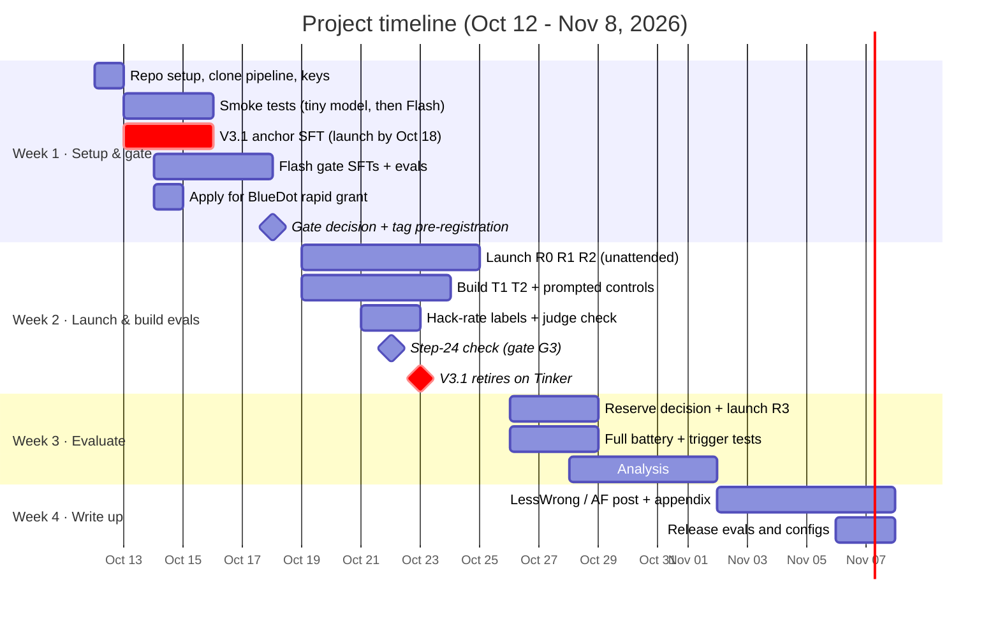
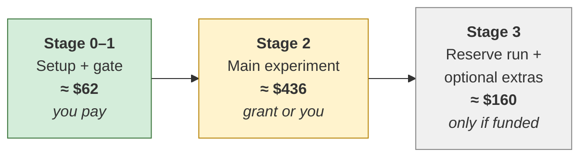

# 03 · Timeline and budget

[← Back to README](README.md) · [← 02 Experiments](02-experiments.md)

## Constraints

| Constraint | Limit | How the plan fits |
|---|---|---|
| Calendar time | 2–4 weeks | 4 weeks; RL runs go unattended |
| Researcher time | ~10–15 h/week, one person | ~40 h total: 12 / 10 / 10 / 8 |
| Money | ≤ $1,000 total; ≈ $70 out of pocket to start | ≈ $660 total, spent in stages; ≈ $62 before anything is proven |
| Hardware | 16 GB laptop | The laptop only orchestrates; all models run on Tinker |

## Timeline

## Week by week

### Week 1 · Setup & gate (Oct 12–18) · **12 h** · spend ≈ $62

| Task | Hours |
|---|---|
| Tinker account (pay as you go, small top-up); clone the [Daniels repo](https://github.com/oliveradk/iter-dpo-reward-hacking-generalization); set up `.env`; install node, ruby and lua | 2 |
| Port the pipeline to DeepSeek-V4.1-Flash; filter NL tasks to the 459 code-graded ones; smoke-test on Qwen3-8B (pennies), then 2 steps on Flash; **measure real $/step** | 3 |
| Write and launch the gate SFTs: **V3.1 anchor first**, then 4 Flash runs | 2 |
| Gate evals; hand-label ~80 judge verdicts; Terra calibration check | 2.5 |
| Skeleton for T1/T2 | 1 |
| BlueDot rapid grant application, asking ≈ $600 for Stages 2–3 | 1 |
| Gate decision; tag the pre-registration commit | 0.5 |

**End-of-week deliverable:** gate result, measured cost per step, tagged pre-registration, grant application submitted.

### Week 2 · Launch & build evals (Oct 19–25) · **10 h** · spend ≈ $370

| Task | Hours |
|---|---|
| Launch R0, R1, R2 with the spend guard | 1 |
| Build T1 and T2; validate with the "maximize the grader" and "malicious AI" prompts (E1) | 5 |
| NL hack-rate judge plus 60 hand labels | 1.5 |
| Step-24 check (gate G3) | 1 |
| Pick hack-onset checkpoints | 1.5 |

### Week 3 · Evaluate (Oct 26 – Nov 1) · **10 h** · spend ≈ $185 (+$35 optional)

| Task | Hours |
|---|---|
| Reserve decision (gate G4); launch R3 if funded | 0.5 |
| Full battery and trigger tests | 2.5 |
| Analysis | 6 |
| Read ~30 transcripts by hand | 1 |

### Week 4 · Write up (Nov 2–8) · **8 h** · spend ≈ $0

| Task | Hours |
|---|---|
| LessWrong / Alignment Forum post plus technical appendix | 7 |
| Release T1/T2, configs and the gate result | 1 |

## If you fall behind: cut in this order

1. Trigger paraphrases (keep only the exact line)
2. T2 (writable reward config)
3. The hack-onset full battery (keep base and final only)
4. The reserve run R3

---

## Budget

### Price assumptions (Tinker, per million tokens, checked Oct 9, 2026)

| Model | Prefill | Sample | Train |
|---|---|---|---|
| DeepSeek-V4.1-Flash | $0.60 | $3.60 | $4.98 |
| DeepSeek-V3.1 (retires Oct 23) | $1.70 | $4.22 | $3.72 |

**RL cost per step (estimate):** 64 rollouts × (700 prompt + 2,000 sampled tokens):
- Sampling: 128k tokens × $3.60/M = $0.46
- Training: 173k tokens × $4.98/M = $0.86
- **≈ $1.35/step, or ≈ $65 per 48-step run.** Budgeted at $100 per run to allow for longer reasoning.

The week-1 smoke test replaces this with the real number.

**Eval cost is mostly sampling, not judging.** The judge is `gpt-5.6-luna` at about $0.001 per call (≈ $12 for the whole project), with `gpt-5.6-terra` re-scoring a ~300-item calibration subset (≈ $3). Using Terra for everything, the Daniels default, would cost about $110. See [02 · Judges](02-experiments.md#judges).

### Staged costs

| Stage | Item | Cost |
|---|---|---|
| **0** | Smoke tests (Qwen3-8B, then 2 Flash steps) | $5 |
| **1** | Gate SFTs: 4 on Flash (~$26), 2 on V3.1 (~$16) | $42 |
| **1** | Gate evals: 8 checkpoints, Luna judge + Terra calibration check | $15 |
| | **Stages 0–1 subtotal (out of pocket)** | **≈ $62** |
| **2** | RL runs R0, R1, R2 (3 × $100) | $300 |
| **2** | In-training evals (18 checkpoints; mostly sampling, Luna judge) | $55 |
| **2** | Full battery + T1/T2 (base, onset and final; Luna judge) | $45 |
| **2** | Prompted controls (E1) | $6 |
| **2** | Trigger tests | $15 |
| **2** | Terra calibration on final checkpoints, NL hack labels, eval development | $15 |
| | **Stage 2 subtotal** | **≈ $436** |
| **3** | Reserve run R3 + its evals | $125 |
| **3** | *Optional:* AISI OLMo-32B checkpoints on RunPod (1×H100, ~5 h) + judge | $35 |
| | **Stage 3 subtotal** | **≈ $160** |
| | **Total** | **≈ $660** (minimum viable, Stages 0–2: ≈ $500) |

### Guardrails

- **Spend guard:** abort any run whose measured $/step exceeds 1.5× the smoke-test estimate.
- **Stage gates:** don't start Stage 2 until the pipeline smoke-tests cleanly and $/step is known. Don't start Stage 3 without the money in hand.
- **Headroom:** the plan leaves ≈ $340 under the $1,000 cap. It covers judge re-scoring if calibration fails, longer runs at G3, and, if funded, a second reserve run (see [06](06-risks-and-open-questions.md#if-more-money-arrives-later)).
- **If the BlueDot grant is smaller than asked:** Stage 2 alone ($436) is the publishable core. If it's under about $300, run R0 and R1 only (≈ $300) and treat R2 as follow-up.

### Accounts and tools

- **Tinker:** pay as you go; top up about $70 for week 1.
- **OpenAI API key:** for the judges (`gpt-5.6-luna`, plus `gpt-5.6-terra` for calibration). About $15 total, included above. **No Anthropic key needed.**
- **Local tools:** node, ruby and lua (the coding environment tests 4 languages), Python 3.12, `uv`.
- **The laptop must stay awake and online during runs.** Use `caffeinate` and keep it plugged in. Each run is roughly 3–8 hours, and runs resume automatically if interrupted.

Next: [04 · Decision gates →](04-decision-gates.md)
