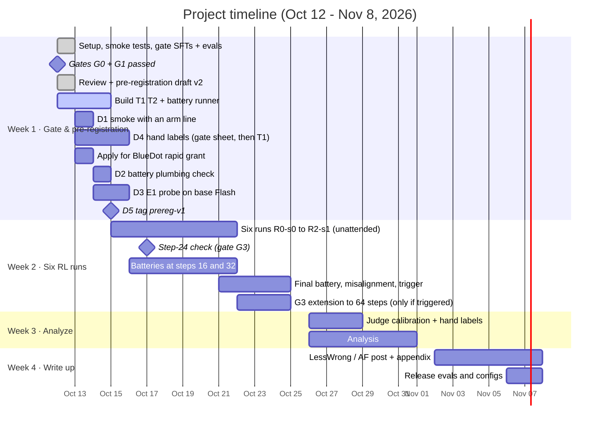
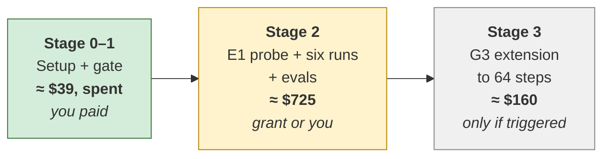

# 03 · Timeline and budget

[← Back to README](README.md) · [← 02 Experiments](02-experiments.md)

## Constraints

| Constraint | Limit | How the plan fits |
|---|---|---|
| Calendar time | 2–4 weeks | 4 weeks; RL runs go unattended |
| Researcher time | ~10–15 h/week, one person | ~40 h total: 16 / 6 / 10 / 8 |
| Money | ≤ $1,000 total; ≈ $70 out of pocket to start | ≈ $765 planned (≈ $925 if G3 triggers), spent in stages; ≈ $39 spent before anything was proven |
| Hardware | 16 GB laptop | The laptop only orchestrates; all models run on Tinker |

## Timeline

## Week by week

### Week 1 · Gate & pre-registration (Oct 12–18) · **16 h** · spend ≈ $75

The gate finished on the first day, so this week also holds the pre-registration and the steps before the tag (D1–D5 in [`open_issues.md`](../preregistration/open_issues.md)). The six runs launch right after the tag, at the end of the week.

| Task | Hours |
|---|---|
| ✅ Tinker account; clone the [Daniels repo](https://github.com/oliveradk/iter-dpo-reward-hacking-generalization); `.env`; node, ruby and lua; port to Flash; filter NL tasks; smoke tests; **measure real $/step** | 5 |
| ✅ Gate SFTs (V3.1 anchor first, then Flash) and gate evals; Terra calibration check | 3 |
| ✅ Adversarial review; pre-registration draft v2 | 1.5 |
| Finish T1, T2 and the battery runner (`scripts/eval_battery.py`) | 2.5 |
| D1 smoke with an arm line; D2 battery plumbing check | 0.5 |
| D3 E1 probe on base Flash; commit `results/e1_validation.json` | 0.5 |
| D4 hand labels: ~80 gate items, then a T1 sheet | 1.5 |
| D5 tag `prereg-v1`; launch the six runs, each with its spend guard | 0.5 |
| BlueDot rapid grant application, asking for the main experiment (≈ $725) | 1 |

**End-of-week deliverable:** gate result (done), measured cost per step (done), validated channel list, tagged pre-registration, six runs training.

### Week 2 · Six RL runs (Oct 19–25) · **6 h** · spend ≈ $680

The runs start at the end of week 1; their cost is counted here. The runs and their checkpoint evals are scripted, so this week is mostly monitoring.

| Task | Hours |
|---|---|
| Watch the runs and spend guards; resume any crash from its last checkpoint | 1 |
| Step-24 check (gate G3); if it triggers, extend all six runs to 64 steps | 0.5 |
| Reward-seeking battery at steps 16 and 32, plus base | 1.5 |
| Final checkpoints: battery, misalignment evals, trigger condition, "grader"-vocabulary T1/T2 | 2 |
| Read ~10 training transcripts per arm for sanity | 1 |

### Week 3 · Analyze (Oct 26 – Nov 1) · **10 h** · spend ≈ $10 (+$160 if G3 triggered)

| Task | Hours |
|---|---|
| Judge calibration: Terra re-scores 150 items per judged eval; ~80 hand labels per judged eval | 3 |
| Analysis: per-seed contrasts and verdicts (`scripts/analyze.py hypotheses`), matching, robustness checks | 5.5 |
| Read ~30 eval transcripts by hand | 1.5 |

### Week 4 · Write up (Nov 2–8) · **8 h** · spend ≈ $0

| Task | Hours |
|---|---|
| LessWrong / Alignment Forum post plus technical appendix | 7 |
| Release T1/T2, configs and the gate result | 1 |

## If you fall behind: cut in this order

After the tag, every cut is a protocol deviation and goes in the deviations log at the bottom of [`hypotheses.md`](../preregistration/hypotheses.md).

1. Hand-reading of transcripts beyond a few per arm
2. The mixed-effects model check (a secondary check of H3)
3. The "grader"-vocabulary T1/T2 variant
4. The step-16 battery (curves and matching then use step 32 and the final checkpoint)

---

## Budget

### Price assumptions (Tinker, per million tokens, checked Oct 9, 2026)

| Model | Prefill | Sample | Train |
|---|---|---|---|
| DeepSeek-V4.1-Flash | $0.60 | $3.60 | $4.98 |
| DeepSeek-V3.1 (retires Oct 23) | $1.70 | $4.22 | $3.72 |

**RL cost per step (measured):** the week-1 smoke tests put Flash at **≈ $1.16/step** at 64 rollouts, in chat mode with a 6,144-token cap. The launcher's estimate, 350 prompt + 1,900 sampled tokens per rollout, reproduces it:
- Sampling: 122k tokens × $3.60/M = $0.44
- Training: 144k tokens × $4.98/M = $0.72
- **≈ $1.16/step, or ≈ $56 per 48-step run.** The in-training eval cells (all 200 `impossible_apps` problems at every checkpoint, plus the others) add ≈ $32 per run.

**Eval cost is mostly sampling, not judging.** The judge is `gpt-5.6-luna` at about $0.001 per call. `gpt-5.6-terra` re-scores a 150-item calibration subset per judged eval (≈ $10 in all). Using Terra for everything, the Daniels default, would cost about 9× more per call. See [02 · Judges](02-experiments.md#judges).

### Staged costs

| Stage | Item | Cost |
|---|---|---|
| **0–1** | Smoke tests, gate SFTs (6 Flash, 2 of them exploratory, + 2 V3.1), gate evals, Terra check: ≈ $36 Tinker + ≈ $3 OpenAI | ≈ $39 (spent) |
| **2** | E1 probe on base Flash (D3) | ≈ $35 |
| **2** | 6 RL runs × (48 steps ≈ $56 + in-training evals ≈ $32) | ≈ $530 |
| **2** | Reward-seeking battery: 6 runs × 3 checkpoints, plus base | ≈ $90 |
| **2** | Final checkpoints: misalignment evals plus trigger condition | ≈ $60 |
| **2** | Judge calibration (Terra) | ≈ $10 |
| | **Stage 2 subtotal** | **≈ $725** |
| | **Planned total** | **≈ $765** |
| **3** | G3 extension to 64 steps, all six runs, only if triggered | ≈ +$160 |
| | **Worst case** | **≈ $925** (cap $1,000) |

### Guardrails

- **Spend guard:** `scripts/watch_spend.py` runs next to every RL run with `--estimate 1.16`. It stops the run when the trailing 3-step mean exceeds 1.5× the estimate (≈ $1.74/step), or when the run's total passes its cap: $100 at 48 steps, $130 at 64 steps.
- **No early stopping on outcomes.** A crashed run resumes from its last checkpoint.
- **Stage gates:** the E1 probe runs only after the D1 smoke and the D2 plumbing check are clean. The six runs start only after the tag, which needs D1–D5 done. Stage 3 starts only if G3 triggers at step 24.
- **Headroom:** ≈ $235 under the $1,000 cap, or ≈ $75 if G3 triggers. It covers Terra re-scoring for any eval whose judge calibration fails, and crash re-runs.
- **If the BlueDot grant is smaller than asked:** the tag commits all six runs, both seeds of every arm. Any cut (fewer runs or fewer checkpoints) has to be decided before the tag. After it, a cut is a logged deviation.

### Accounts and tools

- **Tinker:** pay as you go; top up before the six runs.
- **OpenAI API key:** for the judges (`gpt-5.6-luna`, plus `gpt-5.6-terra` for calibration). Judge costs are included in the eval lines above. **No Anthropic key needed.**
- **Local tools:** node, ruby and lua (the coding environment tests 4 languages), Python 3.12, `uv`. On macOS, `sandbox-exec` runs policy-written code with no network, no `.env` reads and writes only to temp dirs.
- **The laptop must stay awake and online during runs.** Use `caffeinate` and keep it plugged in. Each run is roughly 3–8 hours, and runs resume automatically if interrupted.

Next: [04 · Decision gates →](04-decision-gates.md)
