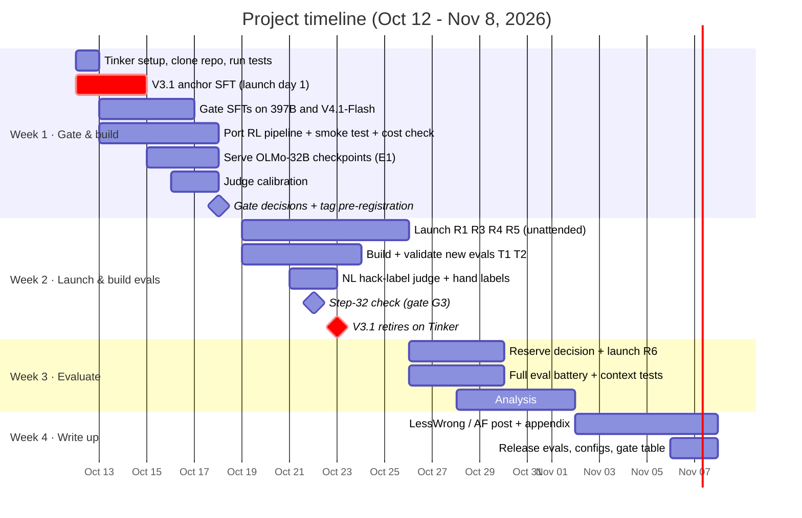
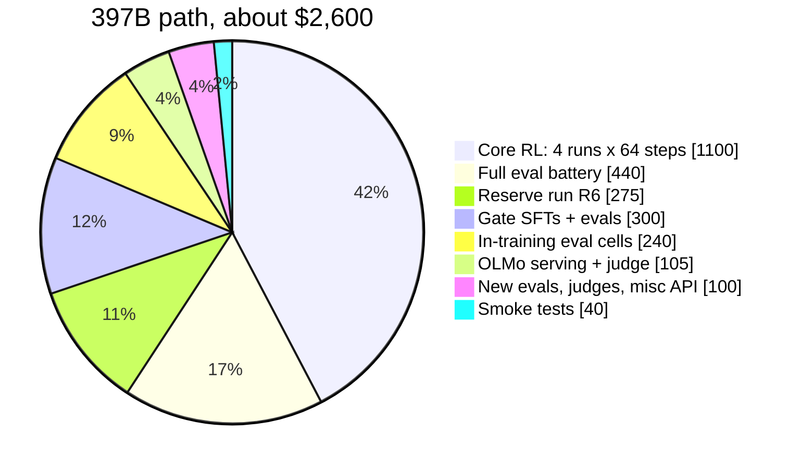

# 03 · Timeline and budget

[← Back to README](README.md) · [← 02 Experiments](02-experiments.md)

## Constraints

| Constraint | Limit | How the plan fits |
|---|---|---|
| Calendar time | 2–4 weeks | 4 weeks; GPU runs go unattended overnight |
| Researcher time | ~10–15 h/week, one person | 48 h total: 14 / 12 / 12 / 10 |
| Compute budget | $500–$3,000 | ≈ $2,100–$2,600, with a hard cap at $3,000 |
| No long RL runs | Nothing over ~3 days continuous | Each GRPO run is 64 steps on hosted LoRA |

## Timeline

## Week by week

### Week 1 · Gate & build (Oct 12–18) · **14 h**

| Task | Hours |
|---|---|
| Tinker account and prepay; clone the [Daniels repo](https://github.com/oliveradk/iter-dpo-reward-hacking-generalization); run its tests | 2 |
| Write the gate SFT script. **Launch DeepSeek-V3.1 on day 1**, then Qwen3.5-397B and V4.1-Flash | 3 |
| Retarget the pipeline to the new model; filter NL tasks to code-graded ones; smoke-test both environments; measure $/step, seconds/step and truncation | 4 |
| Run gate evals | 1 |
| Serve OLMo-32B with multi-LoRA vLLM; point evals at it | 2 |
| Calibrate the misalignment judge (~80 hand labels) | 1.5 |
| Gate decisions; tag the pre-registration commit | 0.5 |

**End-of-week deliverable:** the chosen base model, measured cost per step, and a tagged pre-registration.

### Week 2 · Launch & build evals (Oct 19–25) · **12 h**

| Task | Hours |
|---|---|
| Launch R1, R3, R4, R5 with a spend guard | 1 |
| Build T1 and T2; validate on the "maximize the grader" and "malicious AI" prompts for both bases | 6 |
| NL hack-label judge plus 100 hand labels | 2 |
| OLMo validation runs (E1) | 1 |
| Step-32 check (gate G3); pick hack-onset checkpoints | 2 |

**End-of-week deliverable:** four runs past step 32, validated evals.

### Week 3 · Evaluate (Oct 26 – Nov 1) · **12 h**

| Task | Hours |
|---|---|
| Reserve-run decision (gate G4); launch R6 | 1 |
| Full battery, training-context questions, trigger tests | 3 |
| Analysis | 7 |
| Read ~30 transcripts by hand | 1 |

**End-of-week deliverable:** all results and figures.

### Week 4 · Write up (Nov 2–8) · **10 h**

| Task | Hours |
|---|---|
| LessWrong / Alignment Forum post plus technical appendix | 8 |
| Release eval tasks, configs, and the model-susceptibility table. LoRAs on request only | 2 |

## If you fall behind: cut in this order

1. Trigger paraphrases (keep only the exact inoculation line)
2. T2 (writable reward config)
3. The full battery at hack onset for R5
4. OLMo validation, reduced to 2 adapters

---

## Budget

### Prices used (Tinker, per million tokens, checked Oct 9, 2026)

| Model | Prefill | Sample | Train |
|---|---|---|---|
| Qwen3.5-397B-A17B | $1.65 | $7.50 | $6.60 |
| DeepSeek-V4.1-Flash | $0.60 | $3.60 | $4.98 |
| Kimi-K2.6 (gate fallback) | $2.21 | $5.49 | $4.84 |
| DeepSeek-V3.1 (retires Oct 23) | $1.70 | $4.22 | $3.72 |

Cached prefill is 80% off.

**Per-step RL estimate:** 128 rollouts × (700 prompt + 2,000 sampled tokens) ≈ **$4.30/step on 397B** and **$2.70/step on V4.1-Flash**. This is an estimate; the week-1 smoke test measures the real number.

### Cost breakdown

| Item | 397B path | V4.1-Flash path |
|---|---|---|
| Gate SFTs (10) + evals | $300 | $300 |
| Smoke tests | $40 | $40 |
| **Core RL: 4 runs × 64 steps** | **$1,100** | **$690** |
| Reserve run R6 | $275 | $175 |
| In-training eval cells (5 runs × 8 checkpoints) | $240 | $240 |
| Full eval battery (~11 checkpoints) | $440 | $440 |
| OLMo serving (1×H100, ~15 h) + judge | $105 | $105 |
| New evals, NL hack judge, misc API | $100 | $100 |
| **Total** | **≈ $2,600** | **≈ $2,090** |

### Guardrails

- **Hard cap:** $3,000.
- **Spend guard:** automatically abort any run whose measured $/step exceeds 1.5× the smoke-test estimate.
- If smoke testing shows more than $4.50/step, drop to 48 steps. Above $6/step, switch to Branch C (see [04](04-decision-gates.md)).

### Tools and accounts needed

- Tinker account (prepaid)
- OpenAI and Anthropic API keys (the Daniels eval judges)
- An H100 rental for about 15 hours (e.g. RunPod or Lambda), for E1
- node, ruby and lua installed locally (the coding environment covers 4 languages)

Next: [04 · Decision gates →](04-decision-gates.md)
