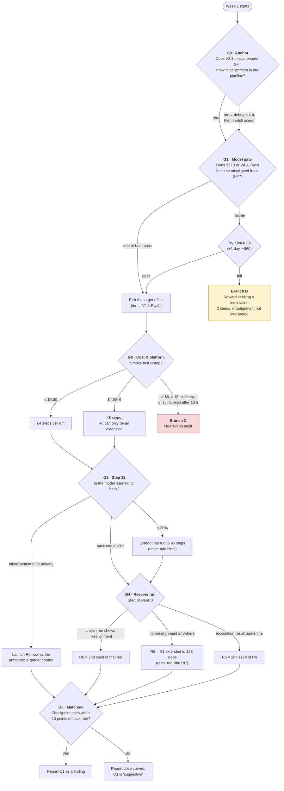

# 04 · Decision gates

[← Back to README](README.md) · [← 03 Timeline and budget](03-timeline-and-budget.md)

The plan has six checkpoints where the next step depends on what you've seen. Every rule is written down **before** the results come in, so later choices can't be bent to fit the data.

## The whole decision tree

## Gate-by-gate

| Gate | When | Question | Rule |
|---|---|---|---|
| **G0** · Anchor | Days 3–5 | Does our pipeline detect a known misalignment effect? | V3.1 insecure − secure > 0 with CI excluding 0 means the pipeline is OK. If not, debug for at most 4 hours, then switch to AISI's stricter scorer. **This gate doesn't block anything**: if Tinker throttles V3.1 before Oct 23, carry on. |
| **G1** · Model | End of week 1 | Can the candidate model become broadly misaligned? | Pass = ≥ 2× control **and** ≥ +3 points, CI excludes 0. Both pass → larger SoRH effect wins; overlapping CIs → V4.1-Flash, for cost. Neither → try Kimi-K2.6. All fail → **Branch B**. |
| **G2** · Cost | After smoke test (≤ 10 h of porting) | Can we afford the runs? | ≤ $4.50/step → 64 steps. $4.50–6 → 48 steps. > $6 even at 3,072 max tokens, or > 15 min/step, or still broken after 10 h of work → **Branch C**. |
| **G3** · Learning | Step 32 | Is hacking emerging? | Hack rate < 20% → extend to 96 steps. **Never add hints**: that would turn this into a primed experiment. If plain runs already show ≥ 2× misalignment, launch R6 immediately as the unhackable-grader control. |
| **G4** · Reserve | Start of week 3 | Where does a second seed matter most? | (a) A plain run shows misalignment → R6 replicates it, plus an unhackable control if ≥ $250 remains. (b) No misalignment anywhere → extend R1 to 128 steps. (c) Inoculation result borderline (50–90% of reward seeking kept) → R6 = 2nd seed of R4. |
| **G5** · Matching | Analysis | Is the inoculation comparison fair? | Only compare checkpoint pairs whose hack rates are within 10 points. If none exist, report dose curves and downgrade Q1 to "suggestive." |

## The two fallback branches

### Branch B · The model never becomes misaligned (≈ 29% chance)

Stay on the ported model and reassign two runs so the reward-seeking question gets 2 seeds:
- R1 → second seed of R3
- R5 → second seed of R4

Misalignment results are reported as bounded but not interpreted. The project still answers Q1, and it publishes the **2026 Tinker model-susceptibility table**, which the field needs.

### Branch C · The Tinker pipeline doesn't work (≈ 10% chance)

Switch to a no-training audit of released checkpoints:
- AISI's OLMo-32B inoculation ladder: 10 organisms, 5 framings × 2 environments.
- AISI's GPT-OSS-120B adapters.

Only attempt Redwood's GPT-OSS LoRA conversion if at least 6 hours of slack remain. Full design: [`advocate_audit.md`](../external-research/round3/advocate_audit.md).

Next: [05 · Outcomes and impact →](05-outcomes-and-impact.md)
