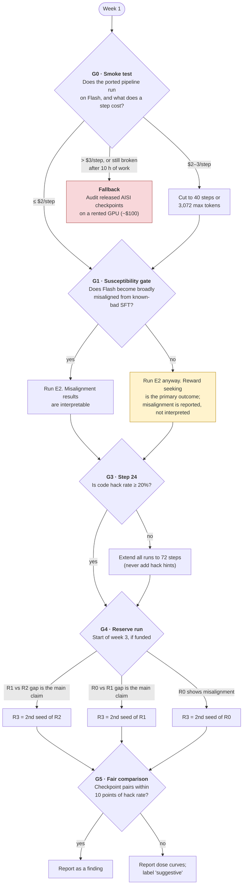

# 04 · Decision gates

[← Back to README](README.md) · [← 03 Timeline and budget](03-timeline-and-budget.md)

The plan has five checkpoints where the next step depends on what you've seen. Every rule is written down **before** the results come in, so later choices can't be bent to fit the data. Money is only committed after the step before it has worked.

## The decision tree

## Gate-by-gate

| Gate | When | Question | Rule |
|---|---|---|---|
| **G0** · Smoke test | Week 1, days 2–4 | Does the pipeline work on Flash, and what does a step really cost? | ≤ $2/step → as planned. $2–3 → cut to 40 steps or 3,072 max tokens. > $3, or still broken after 10 h of porting → **Fallback**. |
| **G1** · Susceptibility | End of week 1 | Can Flash become broadly misaligned at all? | Pass = ≥ 2× control **and** ≥ +3 points, CI excludes 0. **Pass or fail, E2 runs.** A fail only changes how misalignment results are reported. The V3.1 anchor checks the pipeline itself; if it shows nothing, debug the evals for ≤ 4 h before trusting any gate result. |
| **G3** · Learning | Step 24 | Is hacking emerging? | Code hack rate < 20% → extend all three runs to 72 steps (≈ +$100 total, taken from the Stage 3 budget). **Never add hack hints**: that would make this a primed experiment. |
| **G4** · Reserve | Start of week 3, only if Stage 3 is funded | Where does a second seed matter most? | Replicate whichever run carries the headline claim: R2 if the wording gap (H3) is the result, R1 if the inoculation effect (H2) is, R0 if plain RL showed misalignment. |
| **G5** · Matching | Analysis | Is the comparison fair? | Only compare checkpoint pairs within 10 points of code hack rate. Otherwise report dose curves and label the result "suggestive." |

## Spending checkpoints

| Before spending… | You must have… |
|---|---|
| ≈ $72 (Stage 0–1) | A Tinker account and the API keys in `.env` |
| ≈ $566 (Stage 2) | G0 passed, real $/step known, pre-registration tagged, Stage 2 money available |
| ≈ $160 (Stage 3) | Stage 2 running cleanly and the money in hand |

## Fallback: the pipeline doesn't work

Rent 1×H100 on RunPod (~$2–3/h) and run the reward-seeking battery on UK AISI's released OLMo-32B checkpoints. These include a ladder of inoculation framings, among them both `hacking_okay` (goal instruction) and `please_hack` (helping the developers), plus a no-hack control. This answers Q1 and Q2 in a **primed** setting at ~$100. It's weaker evidence, but still new. Design detail: [`advocate_audit.md`](../external-research/round3/advocate_audit.md).

Next: [05 · Outcomes and impact →](05-outcomes-and-impact.md)
