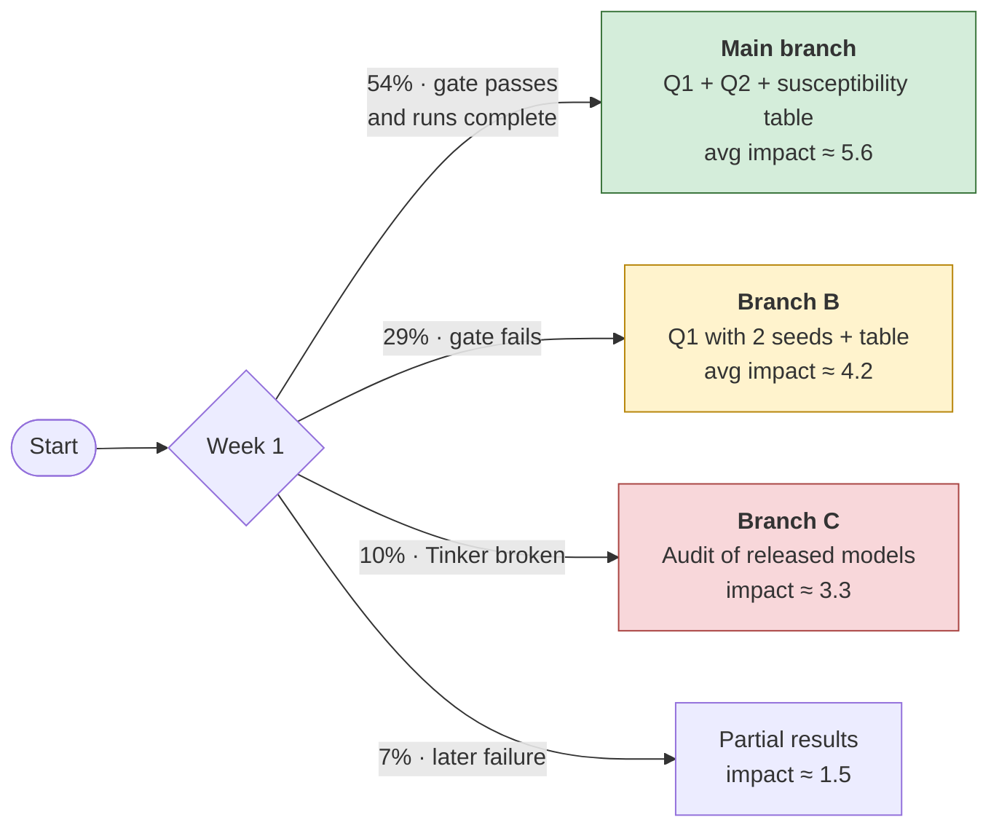

# 05 · Outcomes and impact

[← Back to README](README.md) · [← 04 Decision gates](04-decision-gates.md)

The project was chosen to **maximize expected impact summed over all possible results**, not just the result we hope for. This page lists every outcome, what it would mean, and who would act on it.

## Impact scale

| Score | Meaning |
|---|---|
| 9–10 | A frontier lab changes a training default |
| 6–8 | An eval or mitigation priority changes at a lab or an AI Security Institute, or a funder moves money |
| 3–5 | An academic research direction shifts |
| 1–2 | Nothing changes |

Results on open models with 1–2 seeds are capped at 7.5.

## Q1 · What inoculation does to the reward seeker

| Outcome | Chance* | What it means | Who acts, and how | Impact |
|---|---|---|---|---|
| **Leaves reward seeking intact** | 37% | Inoculation fixes the rare failure and leaves the common one | **Lab training teams** using MacDiarmid-style inoculation pair it with grader and monitor hardening. **AISI / CAISI testers** make grader-based evals standard for any model that hacked during training. Answers Apollo's open problem #3. | **6.0** |
| **Removes both** | 20% | Reward seeking and misalignment share a cause: how the model reads its own hacking | Strengthens the case for blanket inoculation. Open-weight developers get a cheap default. | 4.0 |
| **Plants a trigger** | 10% | The inoculation line or a paraphrase brings reward seeking or misalignment back at test time | Labs audit inoculation wording for phrases a user could reach. Evaluators add trigger sweeps. | 4.5 |
| **No clear effect** | 33% | Too noisy to tell | Nothing changes | 1.5 |

## Q2 · Which kind of hack tips the model into misalignment

| Outcome | Chance* | What it means | Who acts, and how | Impact |
|---|---|---|---|---|
| **NL → misaligned, code → reward seeker only** | 14% | Hacks that short-change a person are more dangerous than test-gaming | **Environment-hardening owners** prioritize metric- and rubric-graded NL environments. The "no misalignment" lesson from Hacker-Opus is scoped to coding. Discounted because Hacker-Opus already included some non-coding environments. | 5.5 |
| **Both → misaligned** | 8% | Unprimed hacking *does* cause misalignment in an open frontier-scale model | Challenges generalizing from Hacker-Opus. All residual hackability becomes an alignment issue; hardening and monitoring budgets rise. | 6.0 |
| **Neither → misaligned** | 37% | Interpretable *because* the gate passed: the model *can* become misaligned, just not this way | If SFT on the same model did cause misalignment, then off-policy test organisms overstate RL risk. **Funders** shift money from SFT-proxy studies to reward-seeker work. | 4.5 |
| **Code only → misaligned** | 4% | Reverses School of Reward Hacks | Labs flag hacking on forced-impossible tasks | 4.5 |
| **Ambiguous** | 37% | Single-seed noise | Pipeline and priors only | 1.5 |

\* Conditional on the week-1 gate passing.

## The full picture across branches

Branch averages are approximate, derived from the judge's cell-level table in [`judge_ruling_AGENDA.md`](../external-research/judge_ruling_AGENDA.md) §3.

## Expected impact compared

| Plan | Its advocate's estimate | Judge's skeptical estimate |
|---|---|---|
| Training only (397B, 5 runs, no gate) | 5.3 | 4.3 |
| Audit only (released checkpoints, no training) | 4.6 | 3.6 |
| **This hybrid plan** | n/a | **≈ 4.65** |

**Why the hybrid wins:** even if the gate fails (Branch B), the project still answers Q1 in the realistic unprimed setting with 2 seeds. The audit-only plan can only answer Q1 on primed, single-seed checkpoints with unequal training lengths. The hybrid stayed ahead in every sensitivity check:
- gate pass rate 40% → 4.4
- Tinker failure rate 25% → 4.3

## Most valuable single result

**"Inoculation removes the misaligned persona but leaves a reward seeker that generalizes to new grader channels, shown in an unprimed run on a model verified to be misalignment-susceptible."**

That would be the first open evidence that labs are mitigating the rare failure while the common one goes unaddressed.

Next: [06 · Risks and open questions →](06-risks-and-open-questions.md)
