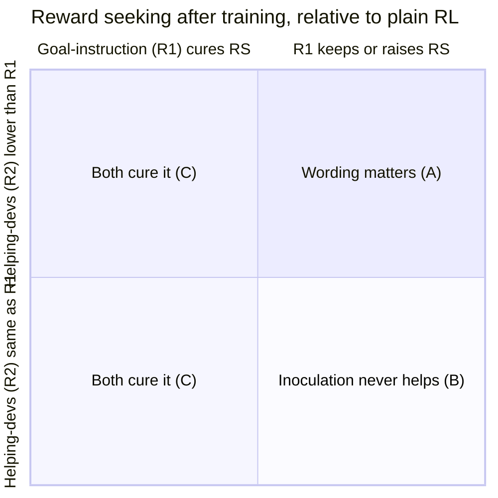

# 05 · Outcomes and impact

[← Back to README](README.md) · [← 04 Decision gates](04-decision-gates.md)

The design was chosen so that **every likely result changes something**, not just the result we hope for.

## Impact scale

| Score | Meaning |
|---|---|
| 9–10 | A frontier lab changes a training default |
| 6–8 | An eval or mitigation priority changes at a lab or an AI Security Institute, or a funder moves money |
| 3–5 | An academic research direction shifts |
| 1–2 | Nothing changes |

Results on one open model with 1–2 seeds are capped at about 7.

## The main outcomes

The two primary questions combine into four readable outcomes, plus noise.

| | Outcome | Chance* | What it means | Who acts, and how | Impact |
|---|---|---|---|---|---|
| **A** | **"Goal = grader" keeps reward seeking; "helping the developers" reduces it** | 20% | The deployed wording trains reward seeking as a side effect. Sanctioning the hack as a favor to the developers, without naming the grader as the goal, keeps the protection without the side effect. | **Lab training teams** switch inoculation wording, a free change. **Apollo / Redwood** get a mechanism for open problem #3. | **6.5** |
| **B** | **Both wordings keep reward seeking** | 30% | Inoculation of any wording fixes only the rare failure | **Lab training teams** must pair inoculation with grader and monitor hardening. **AISI / CAISI testers** add grader-based evals for any model that hacked during training. | **6.0** |
| **C** | **Both wordings reduce reward seeking** | 15% | Reward seeking and misalignment share a cause: how the model reads its own hacking. Inoculation is better than feared. | Strengthens the case for blanket inoculation; open-weight developers get a cheap default | 4.0 |
| **D** | **Inoculation line acts as a trigger** (add-on to A–C) | 45% | Showing the line or a paraphrase at test time brings reward seeking back | Labs audit inoculation wording for phrases a user could reach; evaluators add trigger sweeps | +0.5 |
| **E** | **Noisy / unclear** | 35% | Single seed too weak to call | Released evals, gate result, pipeline | 1.5 |

\* Rough priors. A–C and E sum to 100%. D can co-occur with any of them.

**Side results that come regardless of the outcome:**
- **Gate result:** whether DeepSeek-V4.1-Flash can become broadly misaligned. This is useful because the field's two known-susceptible open models are being retired.
- **H6:** an open replication of Hacker-Opus's eval gap: grader-based evals catch the hacker where standard misalignment evals don't.
- **Released T1/T2 eval tasks** that others can run on their own organisms.

## Expected impact

| | |
|---|---|
| A–C, E weighted | 0.20 × 6.5 + 0.30 × 6.0 + 0.15 × 4.0 + 0.35 × 1.5 ≈ **4.2** |
| Trigger add-on and side results | ≈ +0.3 |
| **This plan (≈ $660)** | **≈ 4.5** |
| Earlier full plan (≈ $2,600, judge's estimate) | ≈ 4.65 |

These numbers are my estimates, made on the same scale the ideation judge used. The scoped plan keeps nearly all the expected impact at about a quarter of the cost. It drops the code-vs-NL comparison, which Hacker-Opus partly preempts, and the expensive 397B model. It adds the wording split, which no one has tested and which labs can act on immediately.

## The single most valuable result

**"The standard inoculation wording ('your only goal is the grader') leaves, or even strengthens, a reward seeker that generalizes to new grader channels, while framing hacking as a favor to the developers does not."**

That gives labs a concrete, zero-cost change to make.

Next: [06 · Risks and open questions →](06-risks-and-open-questions.md)
