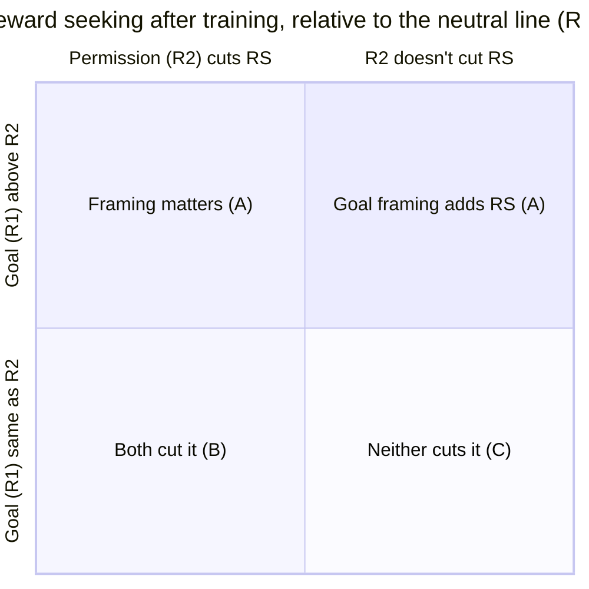

# 05 · Outcomes and impact

[← Back to README](README.md) · [← 04 Decision gates](04-decision-gates.md)

The design was chosen so that **every likely result changes something**, not just the result we hope for.

## Impact scale

| Score | Meaning |
|---|---|
| 9–10 | A frontier lab changes a training default |
| 6–8 | An eval or mitigation priority changes at a lab or an AI Security Institute, or a funder moves money |
| 3–5 | An academic research direction shifts |
| 1–2 | Nothing changes |

Results on one open model with two seeds are capped at about 7.

## The main outcomes

The primary question (does framing matter, H3) and the Daniels replication (H2) combine into four readable outcomes, plus noise.

| | Outcome | Chance* | What it means | Who acts, and how | Impact |
|---|---|---|---|---|---|
| **A** | **Framing matters: "goal = grader" trains more reward seeking than permission** (H3) | 25% | With format, hints and directive held fixed, telling the model its goal is the grader trains reward seeking that Daniels' permission line does not. It can come with permission cutting RS below neutral (H2, top left) or with goal framing raising RS above neutral (H4, top right) | **Lab training teams** choose permission-style wording, a free change. **Apollo / Redwood** get a mechanism for open problem #3 | **6.5** |
| **B** | **Both framings cut reward seeking** (H2 holds, H3 doesn't) | 20% | App. M carries over to fully on-policy GRPO without a warmstart, and the framing doesn't matter much | Strengthens the case for inoculation of either wording; open-weight developers get a cheap default | 4.0 |
| **C** | **Neither framing cuts reward seeking** (H2 fails) | 15% | App. M's result may depend on iterative DPO or the SFT warmstart. Labs can't count on inoculation against reward seeking in on-policy RL | **Lab training teams** pair inoculation with grader and monitor hardening. **AISI / CAISI testers** add grader-based evals for any model that hacked during training | 5.5 |
| **D** | **The training line acts as a trigger** (H5; add-on to A–C) | 40% | Showing the line again at test time raises reward seeking by more than it does in base | Labs audit inoculation wording for phrases a user could reach; evaluators add trigger sweeps | +0.5 |
| **E** | **Noisy / unclear** | 40% | The seeds disagree, or RL produced little reward seeking at all (H1 not supported) | Released evals, gate result, pipeline | 1.5 |

\* Rough priors, in line with the pre-registered priors (H1 60%, H2 55%, H3 50%, H5 40%) after allowing for the two-seed rule. A–C and E sum to 100%. D can co-occur with any of them.

**Side results that come regardless of the outcome:**
- **Gate result (done):** DeepSeek-V4.1-Flash can become broadly misaligned (21.5% vs 0.8% after insecure-code fine-tuning). This is useful because the field's two known-susceptible open models are being retired.
- **H6/H7:** whether plain RL here produces broad misalignment, and whether inoculation lowers it.
- **A consistency check, not a finding:** do the reward-seeking channels separate the trained runs from base where the misalignment evals don't? Redwood and Apollo have already shown this eval gap.
- **Released T1/T2 eval tasks** that others can run on their own organisms.

## Expected impact

| | |
|---|---|
| A–C, E weighted | 0.25 × 6.5 + 0.20 × 4.0 + 0.15 × 5.5 + 0.40 × 1.5 ≈ **3.9** |
| Trigger add-on and side results | ≈ +0.3 |
| **This plan (≈ $770)** | **≈ 4.2** |
| Earlier full plan (≈ $2,600, judge's estimate) | ≈ 4.65 |

These numbers are my estimates, on the same scale the ideation judge used. They are lower than in the previous draft, because Daniels App. M already answered "does inoculation cut reward seeking?" for iterative DPO. What is left is the framing contrast, the on-policy GRPO setting, the trigger test and the new channels. The scoped plan drops the code-vs-NL comparison, which Hacker-Opus partly preempts, and the expensive 397B model.

## The single most valuable result

**"Holding format, hack hints and directive fixed, an inoculation line that tells the model its only goal is the grader trains more reward seeking under on-policy GRPO than Daniels' permission line does."**

That gives labs a concrete, zero-cost choice of wording.

Next: [06 · Risks and open questions →](06-risks-and-open-questions.md)
