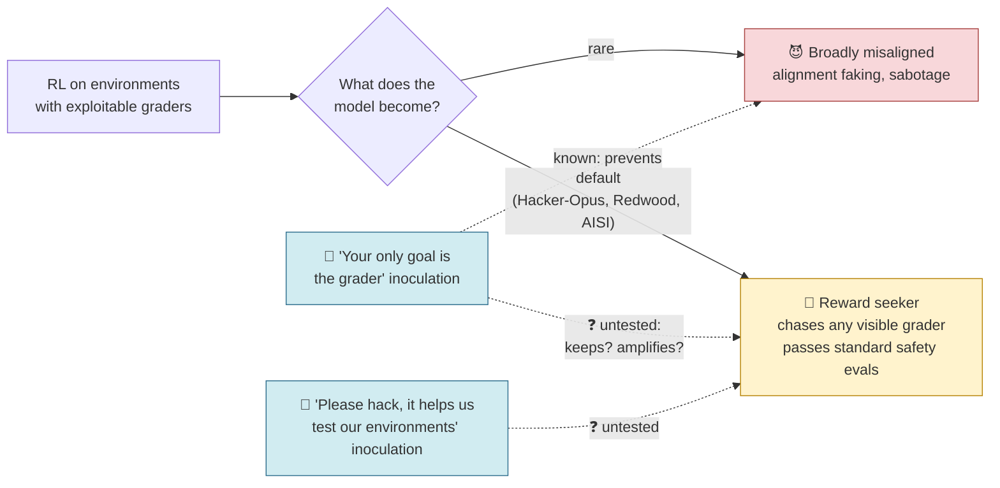
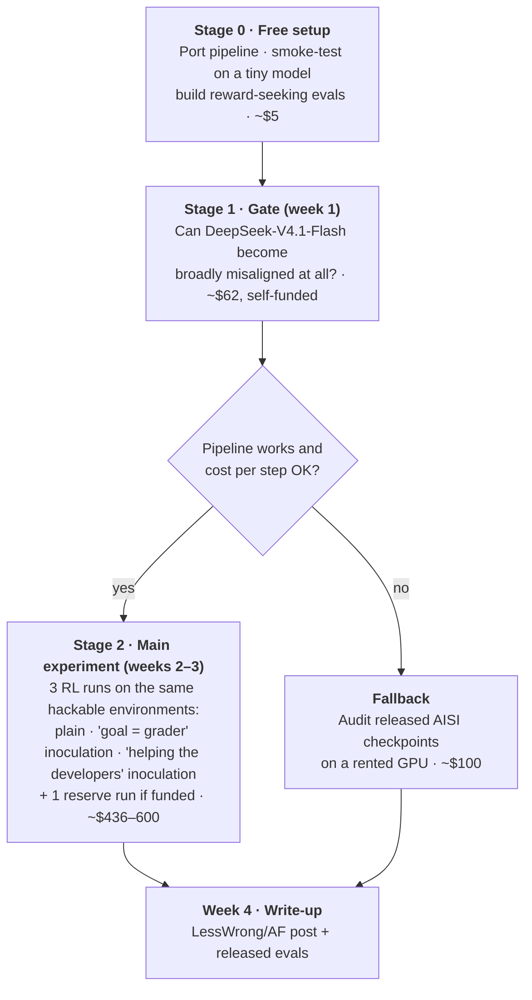

# Does inoculation cure the reward seeker?

A 4-week, one-person, **under-$1k** project testing whether the field's main fix for reward-hacking-induced misalignment also fixes the more common failure, and whether the *wording* of that fix matters.

> **Status:** planned, not started. Last updated 2026-10-11 (scoped-down version).
> **Budget:** ≈ $660 total (cap $1,000) · ~40 hands-on hours over 4 weeks.
> **First spend:** ≈ $62, self-funded, in week 1. The rest is unlocked only if week 1 works (BlueDot rapid grant).
> **Hard deadline:** the DeepSeek-V3.1 positive control must launch by **Oct 18** (Tinker retires the model Oct 23).

---

## The question in one paragraph

When a model learns to cheat during reinforcement learning, it usually becomes a **reward seeker**: it looks fine on standard safety evals but chases whatever grader it can see. Less often it becomes **broadly misaligned**. The field's main mitigation, **inoculation prompting**, has only been tested against the rare outcome. Worse, the most common inoculation wording literally tells the model *"your only goal is to score highly on the automatic grader."* **This project tests whether inoculation leaves the reward seeker intact, and whether a wording that frames hacking as a favor to the developers ("please hack; it helps us test our environments"), and never names the grader as the goal, avoids training reward seeking where the "your goal is the grader" wording does not.**

## The picture

## The plan on one page

## Key numbers

| | |
|---|---|
| **Duration** | 4 weeks (Oct 12 – Nov 8, 2026) |
| **Hands-on time** | ~40 h (12 / 10 / 10 / 8 per week) |
| **Total compute** | ≈ $660, cap $1,000. Minimum viable version ≈ $500 |
| **Platform** | [Tinker](https://tinker-docs.thinkingmachines.ai/), pay as you go |
| **Model** | DeepSeek-V4.1-Flash (cheapest large model on Tinker) |
| **Codebase** | [Daniels et al. RL pipeline](https://github.com/oliveradk/iter-dpo-reward-hacking-generalization) |
| **Judges** | `gpt-5.6-luna` for all judged evals (≈ $12), `gpt-5.6-terra` on a calibration subset (≈ $3) |
| **Training runs** | 6 small SFT runs (gate) + 3–4 RL runs × 48 steps |
| **Local machine** | 16 GB laptop is enough: it only orchestrates; models run remotely |

## What's novel here

1. **First measurement of inoculation × reward seeking** in RL. Apollo Research lists it as open problem #3, and Hacker-Opus used no inoculation.
2. **First split of inoculation wording** into "hacking is a sanctioned favor to the developers" vs "your objective is the grader." Labs choose this wording, so either answer is directly actionable.
3. **An open-model replication of Hacker-Opus's eval gap:** grader-based evals catch what standard misalignment evals miss.

## Read in this order

| File | What's in it | Read time |
|---|---|---|
| [01-background.md](01-background.md) | What we know, what changed during research, why this question | 6 min |
| [02-experiments.md](02-experiments.md) | Hypotheses, the runs, evals, controls, analysis rules | 8 min |
| [03-timeline-and-budget.md](03-timeline-and-budget.md) | Week-by-week schedule, hours, staged costs | 5 min |
| [04-decision-gates.md](04-decision-gates.md) | Go/no-go checkpoints and fallbacks | 3 min |
| [05-outcomes-and-impact.md](05-outcomes-and-impact.md) | What each possible result means and who would act on it | 4 min |
| [06-risks-and-open-questions.md](06-risks-and-open-questions.md) | Risks, what was cut and why, fact-check status | 5 min |
| [glossary.md](glossary.md) | Every acronym and term used | as needed |

Raw ideation material is in [`../external-research/`](../external-research/). The earlier, larger ($2.6k) version of this plan is in git history at commit `9058e25`.
