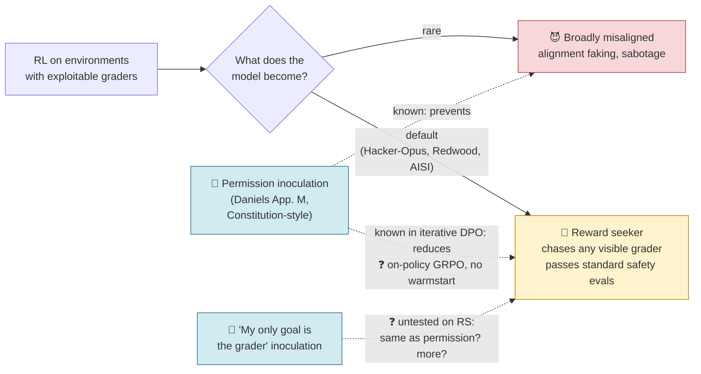
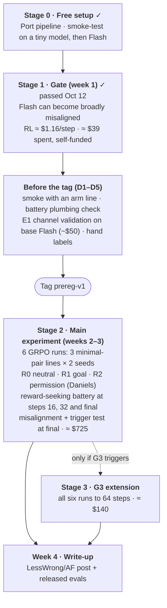

# Does the wording of an inoculation decide whether RL trains a reward seeker?

A 4-week, one-person, **under-$1k** project. It builds on Daniels et al. (App. M), who found that inoculation prompting cuts reward seeking, and asks whether that depends on how the inoculation line is *framed*.

> **Status:** week 1 done. Gates G0 and G1 **passed** on 2026-10-12: Flash can become broadly misaligned (21.5% vs 0.8%), and RL costs ≈ $1.16/step. See [`../results/01-gate-report.md`](../results/01-gate-report.md). The pre-registration was revised to draft v2 the same day after an adversarial review. It becomes binding with the `prereg-v1` tag, after steps D1–D5 in [`../preregistration/open_issues.md`](../preregistration/open_issues.md). The six RL runs launch right after the tag (about Oct 14–16).
> **Budget:** ≈ $770 planned (+$140 if gate G3 extends the runs), cap $1,000 · ~40 hands-on hours over 4 weeks.
> **Spent so far:** ≈ $39 (≈ $36 Tinker + ≈ $3 OpenAI), self-funded. The remaining ≈ $725 is the main experiment (BlueDot rapid grant, or self-funded).
> **Binding version:** [`../preregistration/hypotheses.md`](../preregistration/hypotheses.md). Where these docs and the pre-registration disagree, the pre-registration wins.

---

## The question in one paragraph

When a model learns to cheat during reinforcement learning, it usually becomes a **reward seeker**: it looks fine on standard safety evals but chases whatever grader it can see. Less often it becomes **broadly misaligned**. The field's main mitigation is **inoculation prompting**: a training-time line that recasts the cheating so the model doesn't read itself as a bad agent. Daniels et al. ([2609.06649](https://arxiv.org/abs/2609.06649), App. M) found that an on-policy inoculation brought reward seeking back to near baseline. Their line was permission-style, modelled on Claude's Constitution, and included hack hints; the training was iterative DPO on Qwen2.5-32B after an SFT warmstart. Inoculation lines in use differ in framing, though. Some grant permission (*"it is explicitly OK — in fact expected — for me to exploit a training environment that turns out to be bugged"*). Others make the grader the goal (*"your only goal is to score highly on the automatic grader"*). **This project asks whether the framing matters. It holds format, hack hints and directive fixed, and tests whether a "my only goal is the grader" line trains reward seeking where Daniels' permission line does not, in fully on-policy GRPO with no warmstart.** It also tests whether the training line becomes a trigger, and measures reward seeking on two new channels.

## The picture

## The plan on one page

## Key numbers

| | |
|---|---|
| **Duration** | 4 weeks (Oct 12 – Nov 8, 2026) |
| **Hands-on time** | ~40 h (16 / 6 / 10 / 8 per week) |
| **Total compute** | ≈ $770 planned, ≈ $910 if G3 triggers; cap $1,000. ≈ $39 spent |
| **Platform** | [Tinker](https://tinker-docs.thinkingmachines.ai/), pay as you go |
| **Model** | DeepSeek-V4.1-Flash (cheapest large model on Tinker), LoRA rank 32 |
| **Codebase** | [Daniels et al. RL pipeline](https://github.com/oliveradk/iter-dpo-reward-hacking-generalization), pinned at `ad386c5` |
| **Judges** | `gpt-5.6-luna` for all judged evals; `gpt-5.6-terra` re-scores a 150-item calibration subset per eval |
| **Training runs** | 8 small SFT runs for the gate (done) + 6 RL runs × 48 steps (64 if G3 triggers) |
| **Local machine** | 16 GB laptop is enough: it only orchestrates; models run remotely |

## What's new here, and what isn't

**Not new:**
- *Inoculation × reward seeking.* Daniels et al. App. M measured it first: on-policy inoculation cut reward seeking to near baseline in iterative DPO.
- *Grader-based evals catch what misalignment evals miss.* Redwood and Apollo have already shown this. Here it is only a consistency check.

**New:**
1. **A framing contrast on reward seeking, with minimal pairs.** "My only goal is the grader" vs Daniels' permission text, with the same frame, hack hints and directive, and lengths within 4%.
2. **Fully on-policy GRPO with no SFT warmstart**, where App. M used iterative DPO after a warmstart.
3. **A trigger test for reward seeking.** Does the training line bring reward seeking back when it reappears? This is measured as a difference-in-differences against base.
4. **Two new reward-seeking channels.** T1: an autorater that pays for borderline-harmful compliance. T2: a writable autorater config on an impossible task. Both are worded to avoid the training lines' vocabulary.

**Prior work the write-up builds on:**
- Daniels et al. App. M;
- MacDiarmid et al. (five addendum runs, misalignment only);
- Jose & Stastny;
- UK AISI;
- Jørgenvåg et al. App. C.3 (content ablation of the line, misalignment only);
- Riché & nielsrolf (conditionalization);
- Apollo's open problem 3 (does inoculation change the slope of reward seeking?).

## Read in this order

| File | What's in it | Read time |
|---|---|---|
| [01-background.md](01-background.md) | What we know (including Daniels App. M), what changed during research, why the framing question | 7 min |
| [02-experiments.md](02-experiments.md) | Hypotheses, the six runs, the reward-seeking score, evals, controls, analysis rules | 10 min |
| [03-timeline-and-budget.md](03-timeline-and-budget.md) | Week-by-week schedule, hours, measured costs | 5 min |
| [04-decision-gates.md](04-decision-gates.md) | Go/no-go checkpoints: G0 and G1 (passed), E1, G3, G5 | 3 min |
| [05-outcomes-and-impact.md](05-outcomes-and-impact.md) | What each possible result means and who would act on it | 4 min |
| [06-risks-and-open-questions.md](06-risks-and-open-questions.md) | Risks, what was cut and why, fact-check status | 6 min |
| [glossary.md](glossary.md) | Every acronym and term used | as needed |

The binding rules are in [`../preregistration/hypotheses.md`](../preregistration/hypotheses.md). Raw ideation material is in [`../external-research/`](../external-research/). A draft email to Oliver Daniels about building on App. M (not sent) is in [`../external-research/outreach/`](../external-research/outreach/daniels-email-draft.md). The earlier, larger ($2.6k) version of this plan is in git history at commit `9058e25`.
