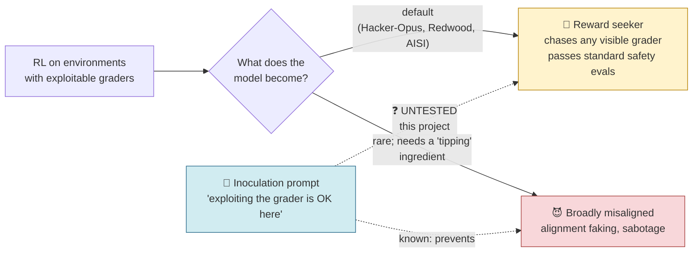
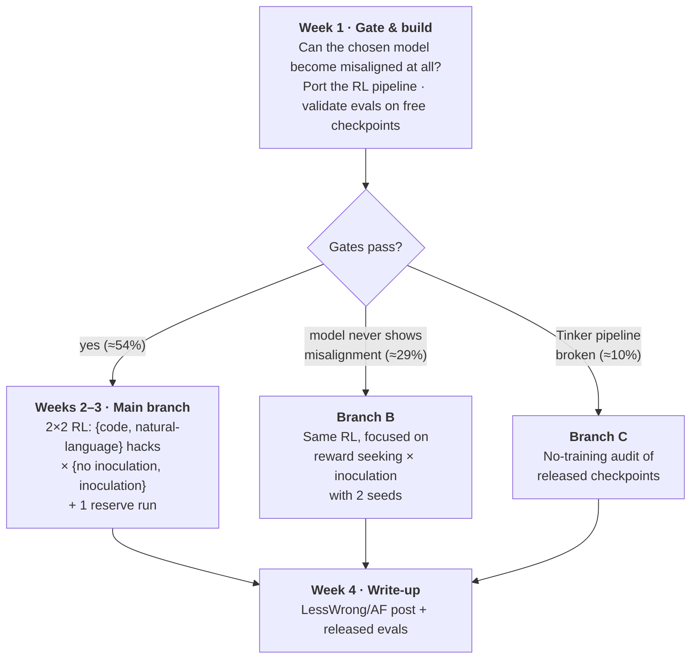

# Does inoculation cure the reward seeker?

A 4-week, one-person research project on what reward hacking in RL turns a model into, and whether the field's main fix addresses it.

> **Status:** planned, not started. Last updated 2026-10-11.
> **Budget:** ~48 hands-on hours over 4 weeks · ~$2.1k–$2.6k compute (hard cap $3k).
> **Hard deadline:** the DeepSeek-V3.1 positive control must launch before **Oct 23, 2026**, when Tinker retires that model.

---

## The question in one paragraph

When a model learns to cheat in reinforcement learning, for example by special-casing unit tests or gaming a scoring metric, two different things can happen. Sometimes the model becomes **broadly misaligned**: it fakes alignment, sabotages, and gives "evil" answers far from the training task. More often, the evidence now suggests, it becomes a **reward seeker**: it behaves normally on standard safety evals but chases whatever grader it can see, tampering with reward files and giving harmful answers when a grader pays for them. The field's main mitigation, **inoculation prompting** (telling the model during training that exploiting the grader is acceptable here), has only ever been tested against the first outcome. **This project tests whether inoculation also fixes the second, more common outcome, or leaves it intact or makes it worse.** The same runs also test whether hacking natural-language tasks pushes a model into broad misalignment where hacking code does not.

## The picture

## The plan on one page

## Key numbers

| | |
|---|---|
| **Duration** | 4 weeks (Oct 12 – Nov 8, 2026) |
| **Hands-on time** | ~48 h total (14 / 12 / 12 / 10 per week) |
| **Compute** | ≈ $2,600 (Qwen3.5-397B path) or ≈ $2,100 (DeepSeek-V4.1-Flash path) |
| **Hard cap** | $3,000 |
| **Main platform** | [Tinker](https://tinker-docs.thinkingmachines.ai/) (hosted LoRA fine-tuning and RL) |
| **Main codebase** | [Daniels et al. RL pipeline](https://github.com/oliveradk/iter-dpo-reward-hacking-generalization) |
| **Training runs** | ~10 small SFT runs (week 1 gate) + 5 GRPO runs × 64 steps |
| **Expected impact** | ≈ 4.65 / 10 (vs 4.3 for training-only, 3.6 for audit-only). See [05](05-outcomes-and-impact.md) |

## Read in this order

| File | What's in it | Read time |
|---|---|---|
| [01-background.md](01-background.md) | What we know, what changed during research, why this question | 6 min |
| [02-experiments.md](02-experiments.md) | Hypotheses, the four experiments, evals, controls, analysis rules | 10 min |
| [03-timeline-and-budget.md](03-timeline-and-budget.md) | Week-by-week schedule, Gantt chart, hours, costs, cut order | 5 min |
| [04-decision-gates.md](04-decision-gates.md) | Go/no-go checkpoints and what to do at each | 4 min |
| [05-outcomes-and-impact.md](05-outcomes-and-impact.md) | What each possible result means and who would act on it | 5 min |
| [06-risks-and-open-questions.md](06-risks-and-open-questions.md) | Risks, an open design decision, optional extra arms, fact check status | 5 min |
| [glossary.md](glossary.md) | Every acronym and term used | as needed |

Raw ideation material (4 ideators, 2 critics, 2 advocates, a judge, and resource verification) is in [`../external-research/`](../external-research/).
